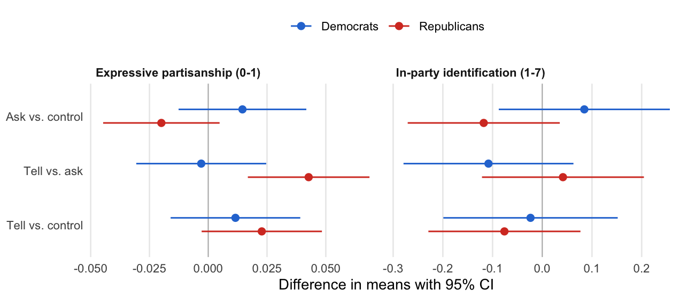

# The Social Construction of Partisanship

Douglas J. Ahler and Gaurav Sood

[Paper](ms/main.pdf) · [Data](data/codebook.md)

## Question

Do people identify with the party whose supporters look like them? Americans overestimate how many of a party's supporters belong to party-stereotypical groups, such as the rich among Republicans and atheists among Democrats. Correcting those beliefs tells most partisans that their party is more like them than they thought. If party identification is a group attachment, the correction should strengthen it. It should do so most for people who overestimated most and for people outside the stereotyped groups.

## Design

The experiment was a TESS study fielded by NORC on its AmeriSpeak probability panel in April 2018. The sample was 2,222 weak partisans and leaners (panel party ID 2, 3, 5 or 6). Within each party-ID category, respondents were randomized to one of three arms:

- **Ask**: guess the share of their party's supporters in three groups, then answer the outcome questions.
- **Tell**: guess, see the true shares, then answer the outcome questions.
- **Control**: answer the outcome questions first and guess at the end.

Democrats were asked about atheists or agnostics, 18–34-year-olds and nonwhites. Republicans were asked about evangelicals, people 65 and older, and people earning $250,000 or more. There were two outcomes:

- a four-item expressive partisanship index (0–1) about the pre-survey party
- the seven-point party identification scale, oriented toward that party

Tell vs. ask isolates the information, because both arms guessed before the outcomes. Estimates condition on the randomization blocks and use HC2 standard errors. Holm adjustment runs over the 18 main tests.

## Findings



- Partisans overestimate the stereotyped groups, Republicans most. The median Republican guessed that 30% of Republicans earn $250,000 or more; the share shown was 4%.
- **Republicans:** the correction raised expressive partisanship by 0.043 relative to only guessing (95% CI 0.017 to 0.069; Holm-adjusted p = 0.02). Part of this comes from guessing alone, which lowered Republicans' attachment slightly relative to control.
- **Democrats:** no effect (−0.003, CI −0.031 to 0.025). The party difference is 0.046 (p = 0.02). This is the reverse of the claim that group concerns bind Democrats and ideology binds Republicans.
- **Party identification:** the seven-point scale did not move in either party. Leaners were no less likely to call themselves independent.
- **Moderation:** the Republican effect did not grow with the size of the misperception, or with how few stereotyped groups the respondent belonged to. Democrats who overestimated more grew slightly less attached when corrected (p = 0.01, Holm-adjusted 0.10). That is the opposite of what the group account predicts.

## Reproduce

You need R 4.6, XeLaTeX and latexmk. Then run:

```sh
make restore   # install the package versions in renv.lock
make check     # analysis, figures, tables, manuscript, lint, tests
```

`make ci-docker` runs the same checks in `rocker/verse:4.6.0`. Every number in the manuscript comes from `tabs/macros.tex`.

## Files

| Path | Contents |
|---|---|
| `data/tess_2018.csv` | Respondent file: arm, guesses, reactions to the correction, outcomes, demographics, weights |
| `data/benchmarks.csv` | Shares shown in the tell arm and the ANES 2016 shares behind them |
| `data/codebook.md` | Every column, with NORC's original names and codes |
| `docs/` | Fielded questionnaire, NORC codebook and field report, and the TESS proposal, which states the hypotheses |
| `R/` | Recodes (`data.R`), estimators (`models.R`), exhibit helpers (`exhibits.R`) |
| `scripts/` | `00_extract.R` (manual: writes `data/` from NORC's SPSS file and the ANES 2016 file), `01_estimate.R`, `02_exhibits.R` |
| `tabs/`, `figs/` | Generated estimates, tables, figures and manuscript macros |
| `ms/` | `main.tex`, `references.bib`, and the compiled `main.pdf` |
| `tests/testthat/` | Recode unit tests, checks on the estimates and the manuscript's numbers, and privacy checks |
